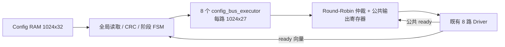

# Config Manager 并行重构设计

## 交付边界

新增 `config_manager_parallel.v`、`config_bus_executor.v`，不改原 `config_manager.v`，不接入任何顶层或工程列表。依赖原工程 `cfg_ram` 与 `crc16_modbus`。验证目录的 CRC 文件为原文件副本，`cfg_ram_model.v` 仅为仿真模型，不能加入真实工程替代厂商 IP。

代码遵循指定 Verilog 编码规范，使用 Verilog-2001 语法、中文意图注释、异步复位的一段式控制 FSM。复用的 CRC 子模块按原实现同步复位。

## 接口与指令

管理器端口与原模块同名、同宽、同方向，输出仍是一路公共 valid/ready WRITE 命令；`o_cmd_rw=0`。新增参数 `SYS_CLK_FREQ=100_000_000`，要求 >=1000 且可被 1000 整除。所有接口在 `i_clk` 域，不加 CDC。

| Record 位 | WRITE（OP=00） | DELAY（OP=01） |
|---|---|---|
| 31:30 | 00 | 01 |
| 29:27 | BUS_ID 0..7 | 忽略 |
| 26:23 | DEVICE_ID 0..15 | 忽略 |
| 22:16 | REG_ADDR 0..127 | 忽略 |
| 15:0 | REG_DATA | 毫秒，0..65535 |

OP=10/11 为非法，发现后本阶段尚未执行的 WRITE 全部丢弃并报 Error。前面已经完成的阶段不会回滚。不新增设备或寄存器白名单。

CRC 仍覆盖每个原始 Record 的全部 32 bit，大端字节顺序、初值 FFFF、反射多项式 A001 不变。DELAY 与保留字段同样参与 CRC。CRC 只校验数据完整性，不验证 OP。CRC 请求优先于执行请求；长度在 CRC 请求时锁存，范围 0..1024。非法长度立即返回 `crc_done=1/crc_ok=0`，之后若错误启动执行则报 Error。执行启动许可仍由上层负责，模块不把 `crc_ok` 作为启动门控。

Config RAM 仅 IDLE 可写；与 start/CRC 请求同拍的写入被禁止。CRC 或执行期间写入被忽略。`crc_ok` 保持到下一次 CRC 请求或复位，写 RAM 不自动清除它，与原上层启动授权约定一致。

## 结构与阶段控制



执行过程：`ST_STAGE_CLEAR → ST_RAM_READ/LOAD → ST_STAGE_START → ST_RUN → ST_DRAIN → ST_DELAY 或下一阶段/Done`。

1. 清空队列指针，从原表顺序读入 WRITE，并按 BUS 分发。遇到 DELAY 或表尾结束本阶段读取。
2. 分发完才统一启动 Executor。同 BUS 的 Record 相对顺序保持，不同 BUS 允许并行在途和乱序完成。
3. Executor 使用同步 RAM 读取队首，并保持到公共输出真正握手。管理器只仲裁 `队首有效 && bus_ready` 的 BUS，成功握手后 Round-Robin 指针移到该 BUS 的下一路，7 后回 0。
4. 公共出口一次锁定一条命令。`i_cmd_ready=0` 时 valid 和 BUS/DEV/ADDR/DATA 保持，不能换 BUS；这段全局反压属于接口约束。尚未选中的 busy BUS 不阻塞其他 ready BUS。Driver 被公共接口选中后不能由其他源抢走：须由既有 System/Top 保证命令所有权和 ready 路由。
5. 所有队列提交完毕后才进入 DRAIN，再等 `i_cfg_bus_ready=FF`。不能把队列空等同于 SPI 已完成。DRAIN 与最后一次提交隔开状态转换，避免把握手前的旧 ready 当成事务完成。
6. 若本阶段以 DELAY 结尾，排空后才开始完整计时；DELAY 0 不进入计时状态。连续 DELAY 和开头 DELAY 可产生空阶段。表尾 DELAY 也必须完成计时再 Done。无指令的空表同样等全 BUS ready 后 Done。

`ST_DELAY` 中每毫秒累计 `SYS_CLK_FREQ/1000` 拍，进入 DELAY 时周期计数为 0。等待 DRAIN 的周期不计入延时，阶段读取及控制开销也不计入设定的毫秒值。DELAY/BARRIER 只确认 SPI 完成，不确认 Ramp 达到目标电压。

## Executor 与容量

8 个相同模块通过参数 `BUS_ID` 例化。队列存储 DEV/ADDR/DATA 共 27 bit，BUS 由实例确定。每路深度固定 1024，写入/读取计数 11 bit，允许计数达到 1024，RAM 地址取低 10 bit。全局合法长度保证单阶段不会写超容量。

Executor：`ST_COLLECT → ST_READ → ST_LOAD → ST_HEAD`；take 后读下一条，最后一条 take 后回 COLLECT。`o_pending` 由读写计数差确定；`o_valid` 仅在队首可用时有效。分发和执行不会重叠，不实现通用流式 FIFO。

RAM 不逐项复位，只清指针及有效状态，便于推断块 RAM。逻辑存储总量为全局 32768 bit，加队列 8×1024×27=221184 bit，共 253952 bit（31 KiB），不含寄存器及物理块 RAM 对齐开销。实际块数与器件容量需后续综合确认。

## 状态、Debug 与异常

- `o_cfg_busy` 从合法执行启动保持到 Done 或 Error/Abort；CRC 期间不置 Busy，与原模块一致，但仍禁止写 RAM。
- `o_cfg_done/o_cfg_error/o_cfg_crc_done` 默认每拍清零，事件时置位一拍。外部 start/CRC 请求应为脉冲，忙期间请求被忽略。
- 内部 `record_index[10:0]` 为原表下一读取/分发位置，正常结束可达 record_count=1024；非法 OP 时停在出错 Record。`cfg_ram_rd_addr[9:0]` 为实际读地址，最后一项后保持，不回绕。Debug 信号不增加外部引脚，也不代表 SPI 完成位置。
- Abort 优先于执行 FSM，组合屏蔽公共 valid，因此 Abort 已在采样沿前有效时该沿不提交命令；同沿清队列并给 Error。取消是 valid 稳定规则的明确例外。
- Config 无独立 fault 输入。沿用 System Controller 故障→`i_cfg_abort` 路径，响应从 Abort 对本模块有效时开始；不声称直接侦测 Driver fault。
- 已握手命令不撤销，由 Driver 自行完成，System Controller 按既有 DRAIN/FAULT 机制排空与恢复。模块不等待排空再回 IDLE，不自动重放。下一次显式启动重新从 Record 0 开始，上层必须先完成排空及故障恢复。
- CRC 阶段不受 Abort 中断。复位清控制状态，不清 RAM 内容。

## 验证与后续接入

验证目录提供可复跑 Cocotb/Icarus 回归，使用同步读 `cfg_ram` 行为模型和原工程 CRC 副本。运行命令：

```powershell
& 'D:\04-software\python3.10\python.exe' 'D:\05-work\29_gpu_test\codex_proj\config_manager_refactor\config_manager_parallel_cocotb\run_cocotb.py'
```

详细结果以同目录验证报告为准。当前不接入顶层，不修改 TD 工程，不做综合、STA、下载或实板验收。后续替换例化时需加入两个新 RTL 文件，并传递顶层 SYS_CLK_FREQ；原有 cfg_ram/CRC 依赖继续保留。
